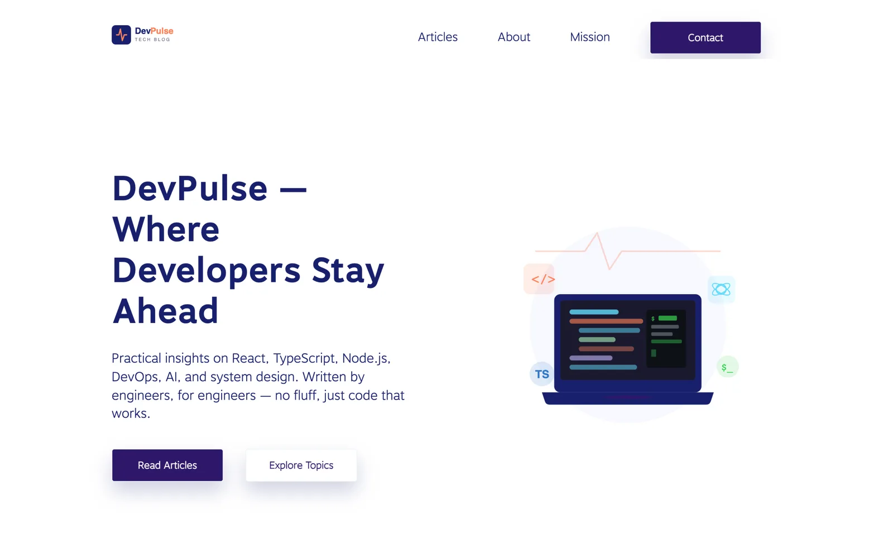
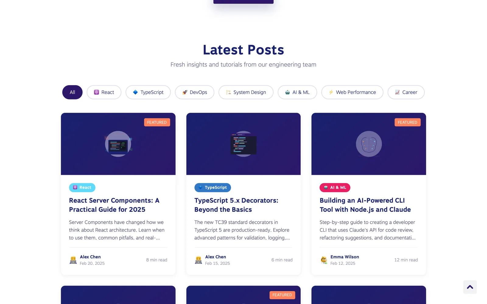

# DevPulse — Developer Tech Blog

> 🚀 **Modern Developer Tech Blog with React & TypeScript** - Practical articles on React, TypeScript, Node.js, DevOps, AI and system design

**DevPulse** is a modern developer tech blog built as a single-page React application with TypeScript, Ant Design and Styled Components. It presents practical engineering articles across categories such as React, TypeScript, Node.js, DevOps, System Design, AI & ML, Web Performance and Career.

The repository demonstrates a clean separation between the data layer and the presentation layer: all blog posts, authors and categories live as typed TypeScript modules under `src/data/`, while components stay purely presentational. It also showcases lazy-loaded routing, scroll-triggered animations and automated deployment to GitHub Pages.


---

## 🎯 Key Features

- 📰 **Blog Post Cards** — Post previews grouped by category, with excerpt, tags, author, date and read time
- 📄 **Post Detail Pages** — Dedicated route (`/post/:id`) rendering the full article content
- 🏷️ **Category System** — Eight typed categories (React, TypeScript, Node.js, DevOps, System Design, AI & ML, Web Performance, Career), each with its own colour and icon
- 🗂️ **Separated Data Layer** — Posts, authors, categories and their TypeScript interfaces live in `src/data/`, independent of the UI
- ⚡ **Lazy-Loaded Routing** — React Router v5 with `HashRouter` and `React.lazy` code splitting per page
- 🎞️ **Scroll Animations** — Reveal-on-scroll effects powered by React Awesome Reveal
- 📬 **Contact Form** — Client-side validation through a custom `useForm` hook and validation rules
- 📜 **Policy Pages** — Privacy Policy and Editorial Guidelines as standalone routes
- 🌐 **i18n Ready** — i18next with browser language detection and English translation files
- 📱 **Responsive Layout** — Mobile-friendly design with a hamburger menu in the header
- 🧩 **PWA Manifest** — Web app manifest with 192/512 icons, standalone display and theme colour
- 🤖 **CI/CD** — GitHub Actions workflow that builds and deploys to GitHub Pages on every push to `main`

---

## 🖼️ Screenshots

| Home Page | Blog Section |
|---|---|
|  |  |

---

## 🛠️ Technology Stack

### Frontend

- **React 18.2** — Component-based UI library
- **TypeScript 4.9** — Static typing across components and the data layer
- **Styled Components 5.3** — CSS-in-JS styling and global styles
- **Ant Design 4.24** — UI component library (grid, form controls, drawer)
- **React Router v5.3** — Client-side routing via `HashRouter`
- **React Awesome Reveal 3.8** — Scroll-triggered reveal animations
- **i18next / react-i18next** — Internationalisation with browser language detection

### Build & Tooling

- **React Scripts 5.0 (Create React App)** — Dev server, build pipeline and Jest test runner
- **ESLint** — `react-app` configuration

### Infrastructure

- **GitHub Actions** — Automated build and deploy workflow (`.github/workflows/deploy.yml`)
- **GitHub Pages** — Static hosting, custom domain configured through `CNAME`

---

## 🚀 Getting Started

### Prerequisites

- **Node.js** >= 14.x
- **npm** >= 6.x (or **yarn** >= 1.22)
- **Git** for version control
- A modern web browser (Chrome, Firefox, Safari, Edge)

### 1. Clone the Repository

```bash
git clone https://github.com/dawidolko/DevTechBlog-Platform-React.git
cd DevTechBlog-Platform-React
```

### 2. Install Dependencies

```bash
npm install
```

### 3. Run

```bash
npm start
```

The app opens at [http://localhost:3000](http://localhost:3000).

To create an optimized production build:

```bash
npm run build
```

The build output is written to the `build/` folder.

### Available Scripts

| Command | Description |
|---------|-------------|
| `npm start` | Start development server on port 3000 |
| `npm run build` | Create optimized production build |
| `npm test` | Run tests with Jest |

### Deployment (GitHub Pages)

This project includes a GitHub Actions workflow that automatically deploys to GitHub Pages on every push to `main`.

**To enable:**

1. Go to your repository **Settings** > **Pages**
2. Under **Source**, select **GitHub Actions**
3. Push to `main` — the workflow will build and deploy automatically

The workflow file is at `.github/workflows/deploy.yml`.

---

## 📁 Project Structure

```
DevTechBlog-Platform-React/
├── 📁 docs/
│   └── 🖼️ screenshots/       # README preview images
├── 📁 public/                # Static assets, index.html, manifest, CNAME, fonts, SVG icons
├── 📁 src/
│   ├── 🧱 common/            # Reusable UI primitives (Button, Input, TextArea, Container,
│   │                         #   SvgIcon, ScrollToTop) + form hooks and validation rules
│   ├── ⚛️ components/        # Feature components (Header, Footer, BlogCard, BlogSection,
│   │                         #   Block, ContentBlock, MiddleBlock, ContactForm)
│   ├── 📝 content/           # JSON content for page sections (Intro, About, Mission, …)
│   ├── 📊 data/              # Data layer — posts.ts, authors.ts, categories.ts, types.ts
│   ├── 🌍 locales/           # i18n translation files (en)
│   ├── 📄 pages/             # Page components (Home, Post, Privacy, Guidelines)
│   ├── 🛣️ router/            # Route configuration and lazy-loading router
│   ├── 🎨 styles/            # Global styles
│   └── 💻 index.tsx          # Application entry point
├── 📦 package.json           # Project metadata and dependencies
├── ⚙️ tsconfig.json          # TypeScript configuration
└── 📖 README.md              # Project documentation
```

---

## 📊 Data Layer

All blog data is stored in `src/data/` and separated from the presentation layer:

- **`posts.ts`** — Blog post entries with title, excerpt, content, metadata
- **`authors.ts`** — Author profiles
- **`categories.ts`** — Category definitions with colors and icons
- **`types.ts`** — TypeScript interfaces for all data models

To add a new blog post, edit `src/data/posts.ts` and add an entry to the `blogPosts` array.

---

## 🌍 Live Demo

The project is deployed and available at: **[https://devtechblog.dawidolko.pl](https://devtechblog.dawidolko.pl)**

---

## 📄 License

This project is open source and available under the [MIT License](LICENSE).

---

## 👨‍💻 Author

Created by **[Dawid Olko](https://github.com/dawidolko)**

- **Website** — [dawidolko.pl](https://dawidolko.pl/)
- **LinkedIn** — [@dawidolko](https://www.linkedin.com/in/dawidolko/)
